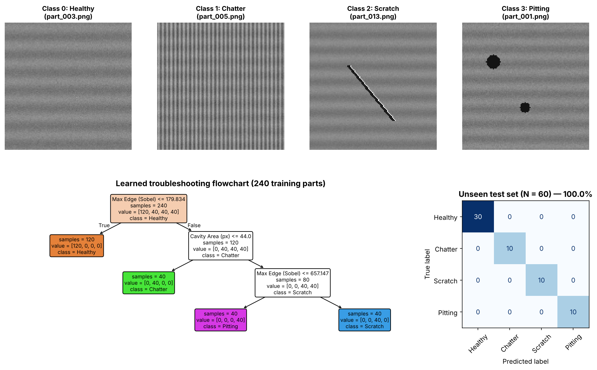
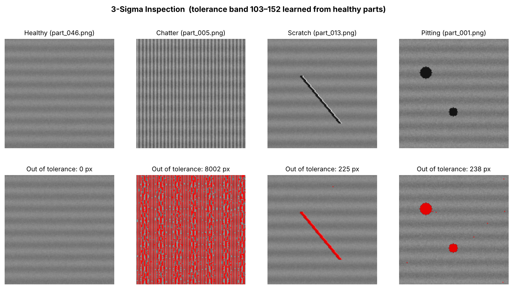
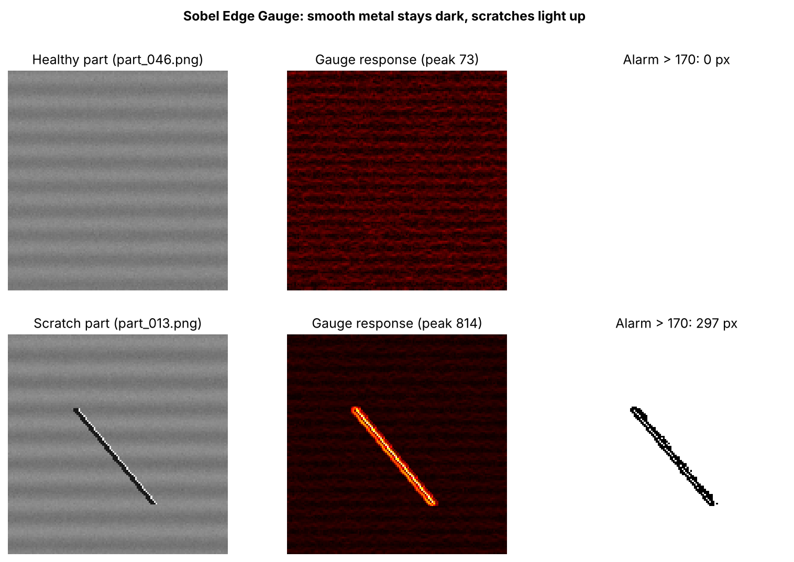
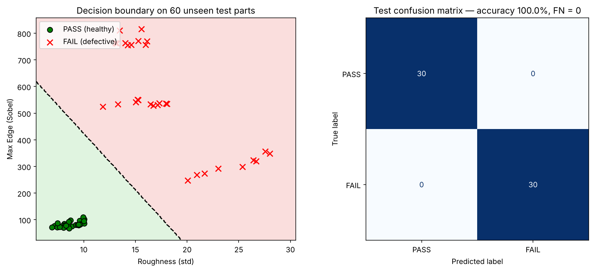
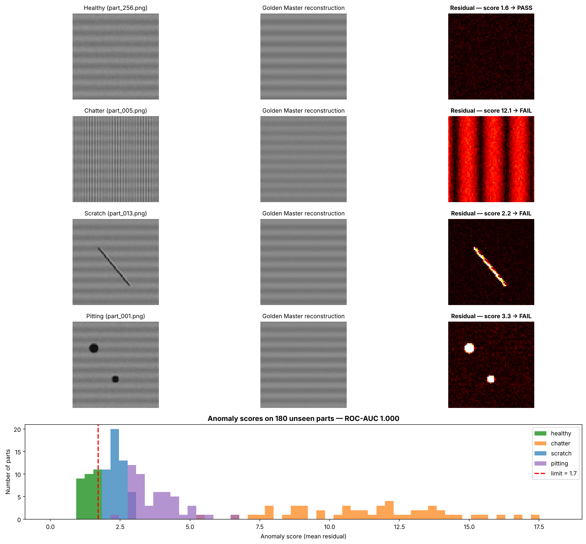

# Surface Defect Detection for Machined Parts

**Classical computer vision and machine learning for automated quality control (QC) on a machining line, explained through machine-shop analogies.**


This project takes a simulated stream of 300 machined-part images and builds up, chapter by chapter, from a simple 3-sigma tolerance check to supervised classifiers and unsupervised anomaly detection. Each step is mapped to a shop-floor idea such as tolerance bands, contour gauges, troubleshooting flowcharts or a golden master part. The goal is to make the data-science reasoning easy to follow.



---

## Table of Contents
1. [Problem](#1-problem)
2. [Dataset](#2-dataset)
3. [Project Structure](#3-project-structure)
4. [Quick Start](#4-quick-start)
5. [Chapters & Results](#5-chapters--results)
6. [Results Summary](#6-results-summary)
7. [Limitations & Next Steps](#7-limitations--next-steps)

---

## 1. Problem

On a production line, every part must be inspected. Manual visual inspection is slow and inconsistent, and a defective part reaching the customer (a **false negative**) costs far more than scrapping a good one. This project answers three questions:

1. **Is the part good or bad?** (binary PASS / FAIL)
2. **If bad, what caused it?** (root-cause triage so maintenance knows what to fix)
3. **Can defects be found without any defect examples?** (unsupervised "golden master")

## 2. Dataset

The dataset is **generated by code** rather than stored in the repo, so it is fully reproducible (fixed random seed).

1. **300 images**, 128 × 128 grayscale, steel-grey surface with machining grain and sensor noise.
2. All images go into **one folder** with serial-number names (`part_001.png` …). As on a real camera line, the filename reveals nothing.
3. Ground truth is stored separately in `data/labels.csv`:

| defect_type | qc_status | count | Shop-floor root cause |
|---|---|---|---|
| healthy | PASS | 150 | — |
| chatter | FAIL | 50 | Spindle vibration / loose clamping |
| scratch | FAIL | 50 | Tool gouge / handling damage |
| pitting | FAIL | 50 | Casting porosity (raw material) |

```
part_id,filename,qc_status,defect_type,is_defective
1,part_001.png,FAIL,pitting,1
3,part_003.png,PASS,healthy,0
```

## 3. Project Structure

```
Surface-Defect-Detection/
├── src/
│   ├── common.py                     # shared paths, image loading, feature extraction
│   ├── 01_generate_dataset.py        # builds data/images/ + data/labels.csv
│   ├── 02_statistical_inspection.py  # 3-sigma tolerance mask
│   ├── 03_edge_gauge_convolution.py  # Sobel convolution (CNN foundation)
│   ├── 04_binary_qc_classifier.py    # Logistic Regression PASS / FAIL
│   ├── 05_multiclass_defect_triage.py# Decision Tree root-cause triage
│   └── 06_golden_master_anomaly.py   # PCA unsupervised anomaly detection
├── assets/                           # result figures (used in this README)
├── data/                             # generated locally, not tracked by git
├── run_all.py                        # runs every chapter in order
├── requirements.txt
└── LICENSE
```

## 4. Quick Start

```bash
# 1. Clone
git clone https://github.com/<your-username>/Surface-Defect-Detection.git
cd Surface-Defect-Detection

# 2. (Recommended) create a virtual environment
python -m venv .venv
# Windows:  .venv\Scripts\activate
# macOS/Linux:  source .venv/bin/activate

# 3. Install dependencies
pip install -r requirements.txt

# 4. Generate the dataset (required once)
python src/01_generate_dataset.py

# 5. Run any chapter, or everything at once
python src/05_multiclass_defect_triage.py
python run_all.py
```

All figures are written to `assets/`.

## 5. Chapters & Results

### Chapter 1: Dataset Generation
`src/01_generate_dataset.py` simulates the camera line and writes `data/images/` and `data/labels.csv`. Uses `numpy.random.default_rng(42)` so every run produces the identical dataset.

### Chapter 2: Statistical Inspection (3-Sigma Rule)

| Concept | Machine shop | Computer vision |
|---|---|---|
| Mean (μ) | Nominal size (pin = 10 mm) | Normal gray level of steel (~128) |
| Std dev (σ) | Allowed natural variation | Normal texture variation from milling grain |
| Defect | Pin measures 15 mm → out of tolerance | Pixel drops to 25 (gouge shadow) |

1. The tolerance band is **learned from 20 healthy reference parts only**: μ ≈ 128, σ ≈ 8 → band 103–152.
2. Any pixel where `|pixel − μ| > 3σ` is flagged.
3. Result: healthy part 0 px flagged; scratch, pitting and chatter are all clearly marked.



### Chapter 3: Convolution as a Sliding Gauge
A 3 × 3 Sobel kernel is slid across the surface like a contour gauge. On flat metal the two sides cancel to ~0, while at a scratch the steep step produces a strong response.

1. The alarm level is calibrated from healthy parts: highest healthy response 113 × 1.5 safety factor → 170.
2. Healthy peak: 73 (no alarm). Scratch peak: 814 (alarm).
3. **Why it matters:** a Convolutional Neural Network (CNN) uses exactly this operation. It simply *learns* the kernel values instead of using hand-designed ones.



### Chapter 4: Binary QC Classifier (PASS / FAIL)
1. **Features:** surface roughness (std dev) and max edge (Sobel peak).
2. **Split:** 240 training / 60 unseen test parts, stratified.
3. **Model:** `StandardScaler` + Logistic Regression (scaling stops the large Sobel values from dominating).
4. **Result:** 100 % accuracy on the unseen batch, **0 false negatives**, 0 false alarms.



### Chapter 5: Multi-Class Defect Triage
Adds a third feature, **cavity area** (pixels darker than 40). A depth-3 Decision Tree learns a readable troubleshooting flowchart:

```
Max Edge ≤ 179.8                → HEALTHY  (ship)
Max Edge > 179.8
├── Cavity Area ≤ 44            → CHATTER  (check spindle / clamping)
└── Cavity Area > 44
    ├── Max Edge ≤ 657.1        → PITTING  (raise with casting supplier)
    └── Max Edge > 657.1        → SCRATCH  (inspect tool edge & handling)
```

**Result:** 60 / 60 unseen parts classified correctly across all 4 classes. (See figure at top of page.)

### Chapter 6: Golden Master Anomaly Detection (Unsupervised)
In real factories, defect examples are rare and new defect types appear without warning. This method learns **only what a good part looks like**:

1. PCA (12 components) is trained on **120 healthy parts only**. No defect images are used.
2. Each incoming part is reconstructed through this "golden master". Residual = |actual − reconstruction|.
3. Healthy metal reconstructs well; a defect cannot be reconstructed and glows in the residual.
4. The PASS / FAIL limit comes from the healthy training scores alone: mean + 3σ = 1.72.
5. **Result on 180 unseen parts:** ROC-AUC 1.000, 0 % false alarms on healthy, 100 % detection of chatter, scratch and pitting.
6. **Note:** scratches score closest to the limit (thin defect, small area), so this is where the method would fail first on real data. Raising PCA components above ~20 starts producing false alarms on healthy parts (overfitting to noise).



## 6. Results Summary

| Chapter | Method | Labels needed | Test set | Result |
|---|---|---|---|---|
| 2 | 3-sigma pixel tolerance | Healthy reference only | 4 sample parts | All defects highlighted, 0 px on healthy |
| 3 | Sobel edge gauge | Healthy reference only | 2 sample parts | Scratch peak 814 vs healthy 73 |
| 4 | Logistic Regression | PASS / FAIL | 60 unseen | 100 % accuracy, 0 FN |
| 5 | Decision Tree | 4 defect classes | 60 unseen | 100 % accuracy |
| 6 | PCA reconstruction | **None** (healthy only) | 180 unseen | ROC-AUC 1.000 |

## 7. Limitations & Next Steps

**Honest caveat:** the data is synthetic and the defect classes are cleanly separated by design, so perfect scores are expected here and **do not** represent real-world performance. The value of this project is the end-to-end methodology: proper train/test splits, thresholds set from healthy data only, and false-negative-aware evaluation.

Planned next steps:
1. Validate on real industrial datasets: NEU-DET Surface Defect Database (hot-rolled steel strip) and [MVTec AD](https://www.mvtec.com/company/research/datasets/mvtec-ad) (anomaly detection).
2. Add realistic nuisances: lighting variation, rotation, blur, oil stains, borderline defects.
3. Use k-fold cross-validation and report confidence intervals.
4. Replace hand-crafted features with a CNN (transfer learning, e.g. ResNet-18) and compare.
5. Replace PCA with a convolutional autoencoder or PatchCore for anomaly localisation.

## Author & License

Developed by **Neeraj Kumar**. Released under the [MIT License](LICENSE).
